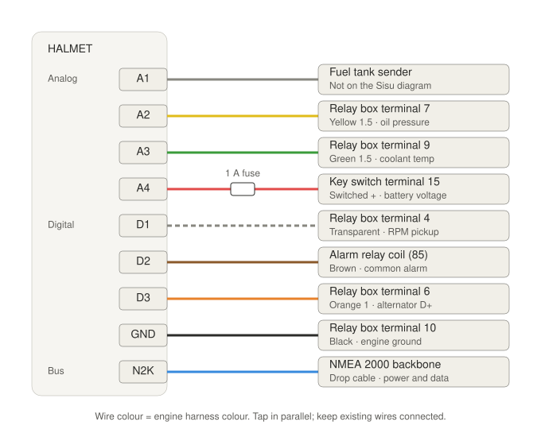

# HALMET Example Firmware

This repository provides example firmware for [HALMET: Hat Labs Marine Engine & Tank interface](https://shop.hatlabs.fi/products/halmet).

To get started with the example firmware, follow the generic SensESP [Getting Started](https://signalk.org/SensESP/pages/getting_started/) instructions but use this repository instead of the SensESP Project Template.

This fork is configured for a Deutz/Sisu diesel (William Knudsen AS wiring diagram 434). It reads the fuel level, oil pressure, coolant temperature, battery voltage, RPM, the common engine alarm and alternator D+, and sends them to Signal K and NMEA 2000.

## Wiring

All connections tap existing wires in parallel, so the original gauges and alarm unit keep working:

- Turn the battery switch off before wiring, and connect GND first.
- Fit a 1 A inline fuse on the A4 wire, close to the key switch.
- For D1, connect the pickup wire that is not grounded.
- Keep the HALMET current source disabled on A2 and A3, since the original gauges are still connected.

After flashing, calibrate the oil pressure and coolant temperature curves, the tacho multiplier and the engine hours in the web UI.

## Customizing

To customize the software for your own purposes, edit the `src/main.cpp` file.
Parts intended to be customized are marked with `EDIT:` comments.
